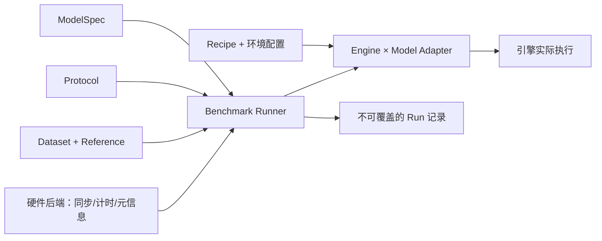

# 架构与职责

## 核心对象

| 对象 | 定义什么 | 不负责什么 | 当前位置 |
|---|---|---|---|
| ModelSpec | 权重版本、模型计算与输入输出语义 | 某次测试的计时方式 | `specs/models/` |
| BenchmarkProtocol | 起止边界、同步、缓存规则、比较约束 | 选择最快的引擎实现 | `specs/protocols/` |
| Dataset | 冻结样本、预处理版本、输入/噪声和哈希 | 修改模型的推理计算 | `specs/datasets/` |
| ReferenceSpec | 参考实现、精度、输出空间和来源 | 自动定义验收阈值 | `specs/references/` |
| Recipe | 引擎执行某模型的一套可复现配置及硬件限制 | 偷改协议来降低延迟 | `recipes/` |
| Platform / Machine | 硬件能力、机器配置、环境和测量控制 | 模型输入语义 | `platforms/` |
| Run | 上述对象的固定组合、实际环境、状态和产物 | 覆盖其他人的测量 | `results/` 索引；`reports/` 既有记录 |

模型、协议、数据集、Recipe 必须分别版本化。相同模型可以使用 raw observation E2E、prepared tensor model-only 或 action-head-only 协议；不同协议不混合排名。



## 执行职责

协议定义“测什么”；Adapter 实现边界之间的完整模型工作；Runner 负责预热、输入检查、误差校验、计时、统计和记录。硬件后端提供同步、完成判定与元信息。

Adapter 不能仅给引擎原生 infer 包一层计时：如果原生入口已经接收 learned embeddings，必须把这部分计算补回 model-only 区间；如果原生入口包含原始图像预处理，就应找到合适的内部入口。无法满足协议时报告不兼容，而不是静默改变边界。

Adapter 通常按“引擎 × 模型”实现，多个 Recipe 共享输入输出适配代码。换硬件时优先复用 Adapter、选择不同引擎 backend；只有输入契约或执行机制确实不同才拆实现。

## 当前可用接口

```python
class Adapter:
    def __init__(self, config, protocol, samples):
        # 加载、校准、固定布局准备；在计时外执行。
        self.metadata = {}

    def infer(self, sample):
        # 当前观测的全部约定计算，返回 device action tensor。
        ...

    def runtime_stats(self):
        # 可选；返回可比较的图/编译状态，Runner 校验预热后未变化。
        ...
```

注册位置：[adapters/__init__.py](../inference_baseline/adapters/__init__.py)。也可在 config.engine 填写 `module:Class`；不是任意 Recipe 名称都可直接作为 engine 使用。`label` 用来区分 FP8/NVFP4 等结果。

当前构造函数承担未来 `prepare()` 的工作；Runner 的 warmup 承担延迟初始化和图捕获。尚无独立 `prepare()`/`close()` 生命周期接口。新增引擎必须确认多 stream 工作在返回和 device sync 后确实完成；远程 RPC/异步服务不能直接复用本地 CUDA 完成判定。

## 实现与目标的差距

现有 `protocol.py`、`dataset.py` 以及 Runner 的 action shape、输入响应检查仍有 GR00T 专属逻辑。目录抽象不是已经支持任意模型的证明。新模型需要先抽出模型插件，再接入；详见 [迁移计划](migration.md)。

新 `specs/*.json` 是带版本的描述性契约，当前执行仍以 config、冻结 dataset manifest、运行时校验和 summary 为依据。冲突时停止测试并修正文档或配置，不挑选对延迟更有利的定义。
